<p align="center"></p>

Two Claude Code mods for the band above the prompt.

`usage-hud` puts four small gauges above the prompt: 5-hour limit, weekly limit, prompt-cache countdown and context used. A limit gauge shows what's left and the time to reset, with a white tick where you'd be at an even pace. A gauge turns red and blinks when a limit drops under 15%, when you're on track to run out before it resets, when the cache has under two minutes left, or when context passes 80%. `⋯` opens two token bars, one for this session and one for every Claude Code session on this computer, each split into cache reads, cache writes, fresh input and output. The lifetime bar is read from the session transcripts under `~/.claude/projects`; usage from other computers or from claude.ai chats isn't counted. A third bar splits the context window by what fills it (conversation, MCP tools, system tools and the rest), since all of it is read from the cache again on every step. Below the bars are pace, projected run-dry time, cache hit rate and cost, plus buttons for the cache TTL, the guard, compaction and the theme.

The session and lifetime bars are counted from the transcripts. Each scan reads only the bytes a transcript gained since the last one, so the HUD stays light in long sessions and a resumed session counts its earlier turns too. The cache countdown starts when a request is sent, and its TTL follows what the session actually writes, 5 minutes or 1 hour.

The cache guard holds a prompt once, puts it back in the prompt box and says why, when sending it would be expensive: the cache has gone cold, so the whole context would be written to it again, or context has just passed 50%, 70% or 85%, so every step re-reads that much. Press Enter again to send it anyway. It never holds a slash command, a prompt with an image, or anything a plugin or a background task sends.

`pocket-pet` is a small pet that sits beside the gauges. Each project gets its own, picked from the project's folder so it's the same one every time you open it: a cat, bunny, bear or fox in one of 8 colours, with markings, an accessory and a name. About one project in eight gets AUDA instead, a black and red baby dragon with a BOSS badge and lines of its own. NYX, a night dragon, and WISP, a grey cat that fades down to its eyes and grin, each turn up in about one project in sixty-four.

The pet reacts to the session. While Claude works, its speech bubble cycles through verbs such as thinking… and brewing…. It has thirteen moods. It gets dizzy when tools fire in a burst, startled when one fails, sad when a turn is stopped, happy when one finishes and proud on every fifth turn in a row. Leave it alone and it gets bored after a minute and falls asleep after three. Now and then an idle pet fades to a faint outline with only its eyes and mouth glowing.

On the desktop app it also notices the pointer. Come within about 20 pixels and it stops, follows the pointer with its eyes and leans that way. Rest the pointer on its face and it squints; press and it squashes and lets off a few hearts. The press is drawn only, because the app gives a mod no click on a drawing, so `♥` is still what counts a pet.

It levels up as it watches turns finish and gets petted, and it gets hungry over about four hours, when a `feed` button appears. Level, pets, hunger, the streak and the bubble theme are kept across sessions.

Both draw as SVG on the desktop app and fall back to plain text in the terminal.

## Install

At the prompt of a terminal session:

```
/plugin install usage-hud --marketplace xzycd/mods
/plugin install pocket-pet --marketplace xzycd/mods
```

From a shell:

```bash
claude plugin install usage-hud --marketplace xzycd/mods
claude plugin install pocket-pet --marketplace xzycd/mods
```

In the desktop app, where `/plugin` doesn't run: click + next to the prompt box, then Plugins, Add marketplace with `xzycd/mods`, then Add plugin.

Answer `y` to add the marketplace, then pick the user scope so the mods load in every session.

## Commands

- `/hud` hides or shows the gauges.
- `/hud guard on` or `/hud guard off` turns the cache guard on or off. It starts on.
- `/hud theme` cycles the colours: ember, ice, mint, gold, violet, mono. `/hud theme ice` picks one.
- `/hud ttl 5` or `/hud ttl 60` fixes the cache countdown; `/hud ttl auto`, the default, follows the session.
- `/mochi` draws a card with your pet, its level and xp bar, turns seen, hearts, streak and hunger.
- `/mochi theme` cycles the bubble's colour: black, slate, plum, forest, ocean, ember. `/mochi theme plum` picks one.
- `/mochi reroll` gives the current project a new pet.
- `/mochi boss` summons AUDA to the current project.
- `/mochi night` summons NYX, and `/mochi grin` summons WISP.
- `/mochi hide` hides the pet in every session, and running it again brings it back.

## Tests

```bash
claude plugin test usage-hud
claude plugin test pocket-pet
```
